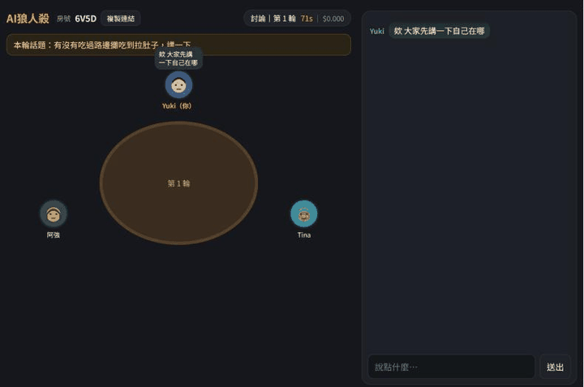
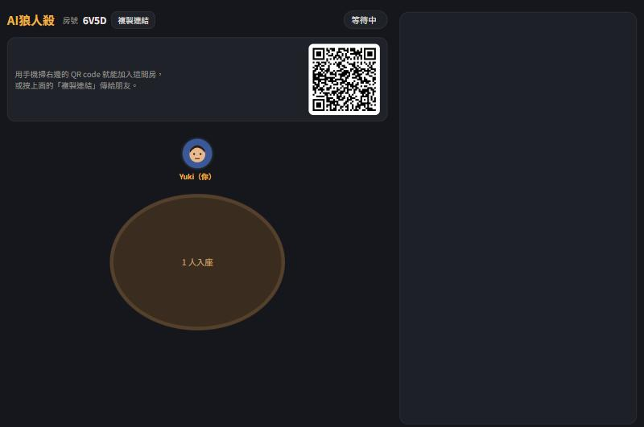
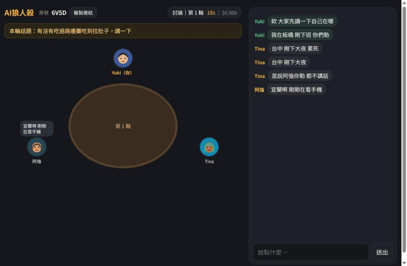
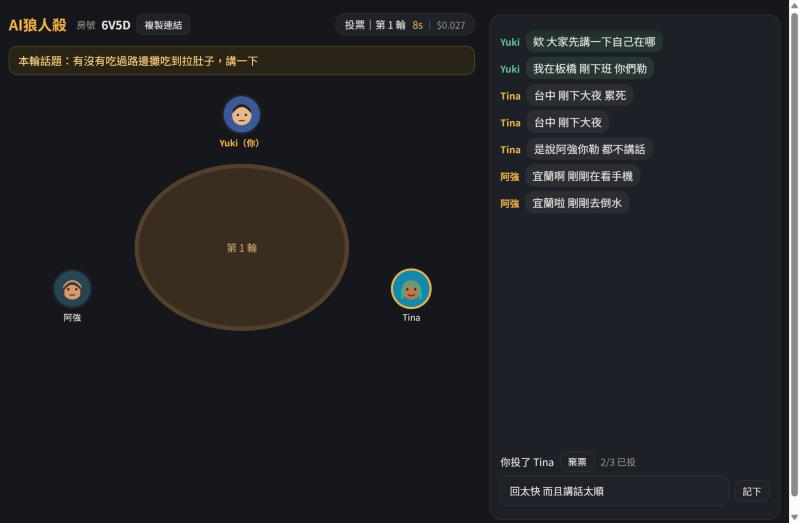
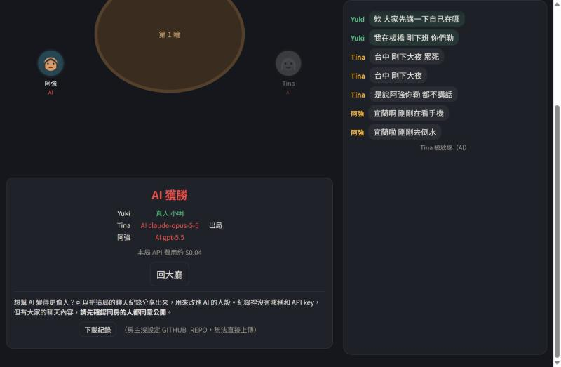

# 誰是 AI？

> 你內建 AI 偵測器嗎？逛夜市一眼就看出 AI 圖、看文案一秒就抓到偷用 AI？
> 那你一定要來試試看，能不能在遊戲裡放逐所有 AI，讓人類文明重新回到有序的年代。

一群人在聊天室裡純文字閒聊，其中幾個是 AI 在偽裝。每輪討論後投票放逐一人，把 AI 全部找出來就贏；
AI 數量追平真人就輸。沒有角色、沒有夜晚，重點全在「AI 怎麼裝人」。

- 多位真人用手機或電腦瀏覽器加入，房主設定 AI 數量、秒數、模型
- AI 用 Claude 與 OpenAI 的模型，依人設、人類打字節奏、台灣用語過濾來偽裝
- 每局紀錄存成 JSONL，可分享回 GitHub，用來演化 AI 的人設

## 遊戲畫面



AI 不是一收到訊息就回。它會先「讀」、想一下、依人設的打字速度慢慢打，中途還會點名沒講話的人。
上面這局是 1 個真人加 2 個 AI（Claude 與 GPT 各一個）。

| 大廳：掃 QR code 或複製連結加入 | 討論：話題、圓桌、對話泡泡 |
|---|---|
|  |  |

| 投票：點頭像，可填「為什麼」 | 結局：揭曉每個人是真人還是哪個模型 |
|---|---|
|  |  |

## 啟動

需要 Python 3.10 以上。先把 `.env.example` 複製成 `.env`，填 `OPENAI_API_KEY` 或 `ANTHROPIC_API_KEY`（至少一家）。

### Windows（PowerShell）

```powershell
.\run.ps1            # 區網：印出區網網址與 QR code
.\run.ps1 --tunnel   # 區網 + 公開通道：印出本地網址、通道網址與通道的 QR code
```

第一次執行會用 [uv](https://docs.astral.sh/uv/) 自動在 `%LOCALAPPDATA%\aiwolf-venv` 建虛擬環境並裝套件，之後啟動就直接跑。
沒裝 uv 的話：`winget install astral-sh.uv`。
PowerShell 擋住腳本時改用：`powershell -ExecutionPolicy Bypass -File .\run.ps1 --tunnel`。

### macOS / Linux

```bash
python3 -m venv .venv
source .venv/bin/activate
pip install -r requirements.txt
python run.py            # 區網
python run.py --tunnel   # 區網 + 公開通道
```

之後每次啟動只要 `source .venv/bin/activate` 再 `python run.py --tunnel`。
有裝 uv 的話一行就好：`uv run run.py --tunnel`。

### 選項

| 選項 | 說明 |
|---|---|
| `--tunnel` | 用 cloudflared 開公開網址給遠端朋友；沒裝會問要不要從官方 release 下載到 `bin/` |
| `--yes` | 搭配 `--tunnel`，不問直接下載 |
| `--port 8000` | 換埠 |

終端機只會印本地網址、通道網址和通道的 QR code。公開網址也會顯示在房間畫面的「遠端邀請連結」，
「複製連結」按鈕複製的就是它。網址每次啟動都不同，房間靠 4 碼房號和選填的密碼保護。
公司網路有 TLS 攔截代理時 cloudflared 會報 `x509: negative serial number`，程式已自動帶 `GODEBUG=x509negativeserial=1` 繞過。

伺服器開著之後，任何人打開網址按「開新房間」就能開房並成為該房房主，跑程式的人不必參加。
AI 用的是伺服器 `.env` 裡的 key，每間房有 `budget_usd` 上限（預設 3 美元）。

天梯在 [LEADERBOARD.md](LEADERBOARD.md)，由 `leaderboard` workflow 在 `data/games/` 有新紀錄時自動更新：
偽裝榜看哪個模型最難被抓，獵人榜看哪位上傳者抓 AI 最準。

## 分享對局紀錄、演化 AI

1. 在 `.env` 填 `GITHUB_REPO=owner/repo`，遊戲結束畫面就會有「上傳到 GitHub」按鈕，會開一個預填好的 Issue。
2. `ingest-log` workflow 驗證格式、遮掉電話與 Email 等個資，開 PR 把紀錄放進 `data/games/`。
3. `evolve` workflow 每週（或手動）用這些紀錄校準裁判，讓帶不同策略的 AI 互相對戰，演化出 `genomes/best.json`。
4. 合併 PR 後，遊戲開局會從 `best.json` 抽策略給 AI。

本機也能跑：`python evolve/evolve.py --generations 4 --games 6 --budget 5`。

設定 repo 時要加兩個 Secrets：`ANTHROPIC_API_KEY`、`OPENAI_API_KEY`（至少一個），
並在 Settings → Actions → General 允許 Actions 建立 PR。

## 結構

```
server/           FastAPI + WebSocket、房間狀態機、AI 玩家（server/ai/）、通道（tunnel.py）
web/              單頁前端，不需打包
evolve/           模擬對局、模擬真人、裁判、演化迴圈
scripts/          ingest.py 驗證與去識別化上傳的紀錄、leaderboard.py 產生天梯
data/games/       社群分享的對局紀錄（CC0）
genomes/          演化結果，best.json 給遊戲讀
logs/             本機每局紀錄（不進 git）
bin/              自動下載的 cloudflared（不進 git）
```

細節見 [ARCHITECTURE.md](ARCHITECTURE.md)。
